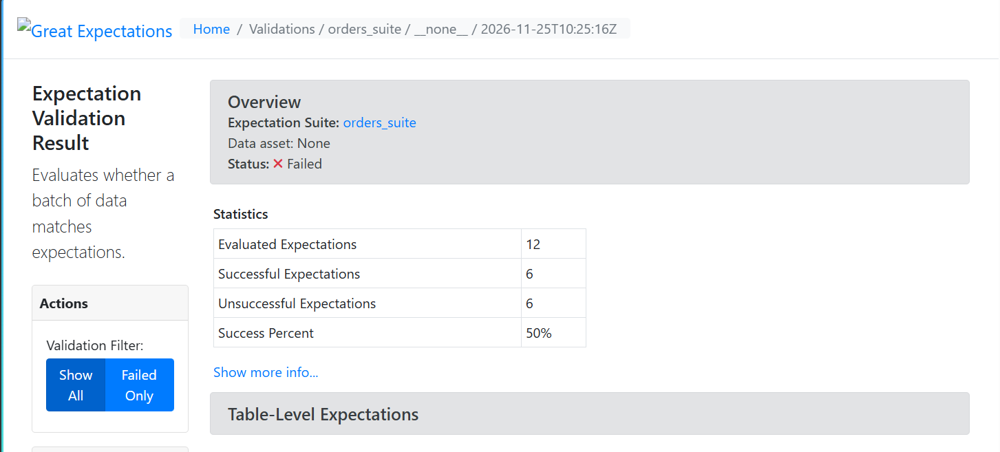

# Answer exo 3

# Answer exo 4

One test (and a data contract) was missing: the payments team changed the unit of the amount from euros to cents, and no range or distribution checks verified the consistency of the amounts before they were loaded.
